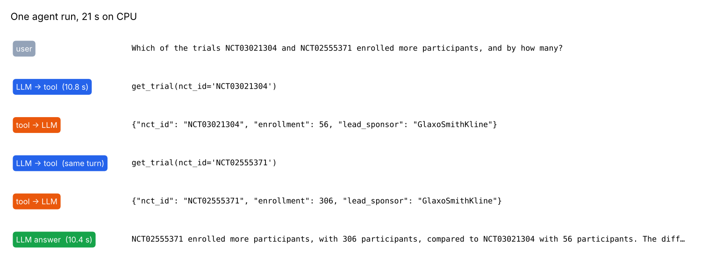
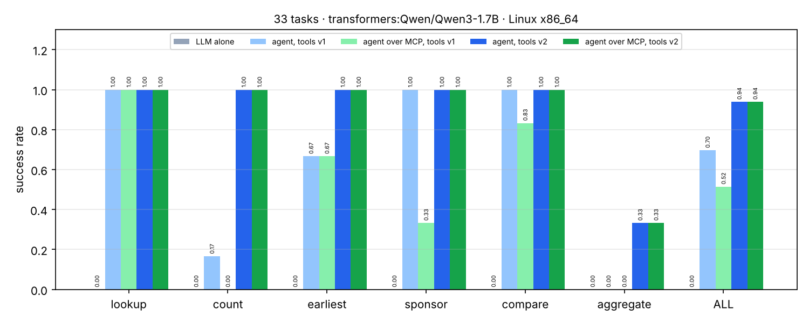

# 16 · P8: AI agent from scratch + MCP server over ClinicalTrials.gov

🇸🇰 [Slovenská verzia](README.sk.md)

## TL;DR
- An agent loop written from scratch (ask the model → run the tools it asked for → feed results back → repeat),
  four typed tools over the public ClinicalTrials.gov API, and the same tools served as an **MCP server**. The agent
  can use the tools either imported directly or over MCP (stdio), without any change to the loop.
- 33 tasks in 6 types that need 1–4 tool calls (lookup, count, earliest trial, sponsor, compare two trials, total
  enrollment). The gold answers are computed by code with the same tools.
- **Qwen3-1.7B on a CPU: 0 / 33 with the LLM alone → 69.7 % as an agent → 93.9 % after rewriting the tool
  descriptions (v2).** Over MCP the v2 agent also scores 93.9 %, succeeding and failing on exactly the same tasks,
  with 0 tool errors.
- Three lessons, each with a number: the eval's cache design (36.4 % → 69.7 %), tool descriptions (69.7 % →
  93.9 %), and the MCP stdio environment (51.5 % → 93.9 %).



## Problem
"How many completed Phase 3 trials of dupilumab for asthma exist?" or "which of these two trials enrolled more, and
by how many?" can't be answered from a model's weights: the facts live in a database that changes every day. An
agent fixes that by letting the model call tools. This step answers:
1. how much tools add over the same model alone,
2. what decides whether a small model uses the tools correctly,
3. whether serving the tools through MCP, the protocol IDEs and assistants use, changes anything.

## Setup
- **Tools** (`ctgov/tools.py`): `search_trials`, `count_trials`, `get_trial`, `calculator` (a safe arithmetic
  parser, no `eval`).
- **Data:** the ClinicalTrials.gov API v2 behind a record/replay cache (`eval/cache/`, committed, 1.3 MB). Every API
  answer the eval needed is stored, so re-runs are offline and reproducible.
- **Tasks** (`eval/tasks.jsonl`, seed 0): 6 count, 6 lookup, 6 earliest, 6 sponsor, 6 compare, 3 aggregate, over 16
  drug–disease pairs.
- **Model:** `Qwen/Qwen3-1.7B` via transformers, greedy decoding, thinking off. It ran on a cloud Linux CPU (4 cores),
  because the session has no Ollama. On the Mac the default is `qwen3:4b` in Ollama, which hasn't been measured.
- **Scoring** (`eval/run_eval.py`): rule checks against the gold value: the number is present, the NCT id is present,
  the sponsor name matches, and for compare both the winner and the difference are right.

## How it works
- **The loop** (`agent/loop.py`, ~100 lines): the messages list goes to the model together with the tool schemas. If
  the model returns tool calls, each one runs, its JSON result goes back as a `tool` message, and the loop repeats
  until the model answers in plain text. The guard rails are what make it production-shaped:
  - `max_steps`, so a confused model can't loop forever,
  - tool errors returned as data, so the model can fix its own call,
  - tool output truncated at 4000 characters, so one huge result can't push the question out of the context,
  - a full trace of every step, which is how every finding below was found.
- **Function calling is just text** (`agent/llm.py`). Ollama parses tool calls for you. With a raw Hugging Face model
  the loop parses Qwen3's `<tool_call>{json}</tool_call>` tags itself, and malformed calls are counted, not crashed on.
- **Schemas from type hints.** `tool_schemas()` builds the JSON schema from each function's signature with pydantic,
  and the same model validates the arguments. Code and schema can't drift, and a bad argument becomes a readable
  error.
- **MCP server** (`mcp_server/server.py`, MCP Python SDK 2.x `MCPServer`): the same functions registered as MCP
  tools. Expected errors are re-raised as `ToolError`, because MCP otherwise hides them behind "Error executing
  tool", and the model then can't correct itself. Any MCP client can use it:
  `claude mcp add clinical-trials -- uv run --directory "$PWD" python -m mcp_server.server`.
- **MCP client** (`agent/mcp_tools.py`): starts the server as a subprocess, runs the MCP handshake, converts
  `list_tools()` into the same schema format and forwards `call_tool()`. The SDK is async, so it runs on a background
  event loop and the agent loop stays synchronous.
- **Visual example:** the message trace above. The Racing Lab cars were not used because an agent calling a
  registry API has no natural driving analogue.

## Results
| Variant | Success | Tool calls / task | Tool calls with an error | p50 / p95 latency |
|---|---|---|---|---|
| LLM alone (baseline) | 0.000 | 0 | – | 1 / 13 s |
| agent, tools v1, replay-only cache (broken eval) | 0.364 | 2.06 | 73.5 % | – |
| agent, tools v1 | 0.697 | 1.18 | 0 % | 58 / 286 s* |
| agent over MCP, tools v1 (minimal server env) | 0.515 | 1.18 | 10.3 % | 21 / 62 s |
| **agent, tools v2** | **0.939** | 1.24 | 0 % | 23 / 65 s |
| **agent over MCP, tools v2** | **0.939** | 1.21 | 0 % | 24 / 81 s |

\* measured while other CPU-heavy jobs shared the machine, so it isn't comparable.



## Error analysis
- **The LLM alone said "I don't know" to 25 of 33 tasks and guessed wrong on the other 8.** That's the honest
  baseline: none of these facts can be in its weights.
- **A broken eval looked like a weak agent (36.4 %).** The first run used a replay-only cache: any API query the task
  builder hadn't made itself, such as `max_results=10` instead of 25, failed, so 73.5 % of tool calls ended in an
  error. Switching to record-through (cache hit → stored answer, miss → fetch once and store) gave the same agent
  69.7 % with 0 tool errors.
- **Tool descriptions mattered more than anything else (69.7 % → 93.9 %).** In v1 the model put the drug into
  `condition` and left `intervention` empty (`search_trials(condition='esketamine')`), so it counted every trial that
  mentions esketamine anywhere: 17 instead of 12. Count tasks went from 1 / 6 to 6 / 6, and earliest from 4 / 6 to
  6 / 6, after v2 added one sentence per argument with an example ("the disease, e.g. 'psoriasis'", "the drug,
  e.g. 'bimekizumab'"). This was tuned on the same 33 tasks, so part of the jump may not carry over to new ones.
- **MCP v1 lost 18 points for two reasons, neither of them MCP's fault.**
  - The SDK starts a stdio server with a minimal environment on purpose, so a third-party server can't read your
    keys. The server didn't inherit the proxy settings, so every query that missed the cache failed (4 tasks). The
    fix is an explicit allow-list of variables (`server_env()`).
  - The MCP server renders the same tools into slightly different JSON (titles, key order). With greedy decoding,
    that alone changed 17 of 33 answers of a 1.7B model.

  With v2 the two paths succeed on exactly the same 33 tasks, though only 18 answers are word-for-word identical.
- **The remaining 2 failures: arithmetic in the head.** In both aggregate tasks the model listed the right
  enrollments ("1307 + 588 + 684 + 527 + 2877 + 290 = …") and then summed them wrong (6595 instead of 6273), although
  `calculator` was available and its description says to use it for sums. It called the calculator once in 33 tasks.
  Bigger models do this less. A guard rail that evaluates any arithmetic in the final answer would fix it here.

## What I learned
- An agent is a 100-line loop. The engineering is in the guard rails, the tool design and the eval.
- Tool descriptions are prompts: the biggest gain came from documenting the arguments, not from the model or the loop.
- Check the eval before the model. Two of three "agent failures" here were the eval's fault or the environment's.
- MCP makes tools reusable across clients, but the transport has its own rules (environment, error reporting), and
  a small model is sensitive to how a schema is rendered.

## Run it
```bash
uv sync                                   # add --extra hf to run a Hugging Face model in-process
make test                                 # offline: the cache replays the API, the LLM is scripted
make demo                                 # one task with a printed trace (needs Ollama + qwen3:4b)
make eval                                 # all variants → results.json, eval/runs/*.jsonl
LLM_PROVIDER=transformers LLM_MODEL=Qwen/Qwen3-1.7B uv run python eval/run_eval.py --variants agent agent_mcp --tag v2
make plot
claude mcp add clinical-trials -- uv run --directory "$PWD" python -m mcp_server.server   # use the tools in Claude Code
```

## Limitations
- 33 tasks is a small set. A difference of one task is 3 points, so only the large gaps above are meaningful.
- The tasks are templated, and the v2 descriptions were improved after looking at failures on the same tasks.
- Measured with Qwen3-1.7B on a CPU. A larger model (`qwen3:4b` on the Mac, or a hosted model) would likely close
  the arithmetic gap and be less sensitive to the schema rendering.
- Single-agent, read-only tools. No planning across many steps, no write actions, no human approval step.
