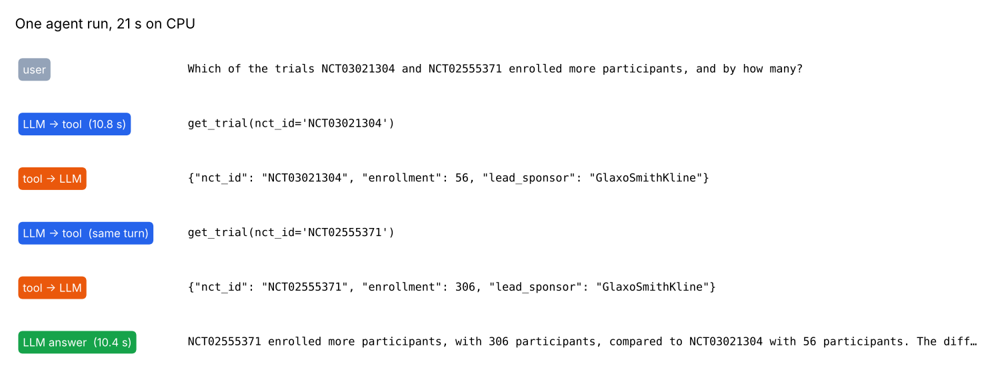
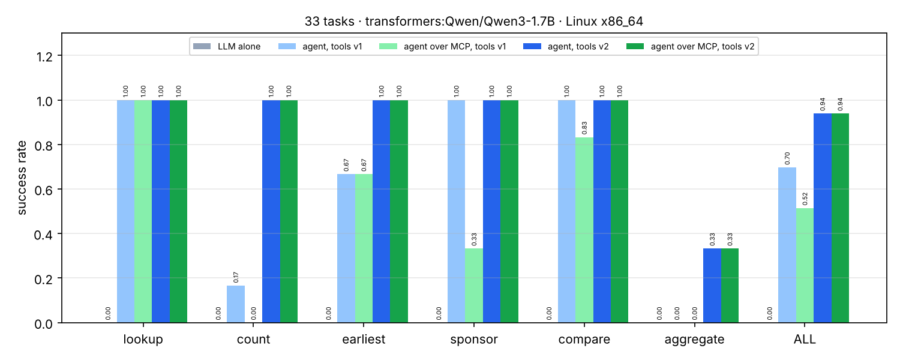

# 16 · P8: AI agent od nuly + MCP server nad ClinicalTrials.gov

🇬🇧 [English version](README.md)

## TL;DR
- Agent loop napísaný od nuly (opýtaj sa modelu → spusti nástroje, ktoré si vypýtal → vráť mu výsledky → opakuj),
  štyri typované nástroje nad verejným ClinicalTrials.gov API a tie isté nástroje ako **MCP server**. Agent ich vie
  používať priamo importované aj cez MCP (stdio), bez akejkoľvek zmeny v loope.
- 33 úloh v 6 typoch, ktoré potrebujú 1–4 volania nástrojov (lookup, počet, najskoršia štúdia, sponzor, porovnanie
  dvoch štúdií, celkový počet účastníkov). Gold odpovede počíta kód tými istými nástrojmi.
- **Qwen3-1.7B na CPU: samotné LLM 0 / 33 → agent 69,7 % → 93,9 % po prepísaní popisov nástrojov (v2).** Cez MCP
  má v2 agent tiež 93,9 %: uspeje aj zlyhá presne na tých istých úlohách, s 0 chybami nástrojov.
- Tri ponaučenia, každé s číslom: návrh cache v evale (36,4 % → 69,7 %), popisy nástrojov (69,7 % → 93,9 %)
  a prostredie MCP stdio servera (51,5 % → 93,9 %).



## Problém
Na otázky ako „koľko ukončených štúdií fázy 3 s dupilumabom pri astme existuje?“ alebo „ktorá z týchto dvoch štúdií
zaradila viac účastníkov a o koľko?“ sa nedá odpovedať z váh modelu: fakty sú v databáze, ktorá sa mení každý deň.
Agent to rieši tak, že model smie volať nástroje. Tento krok odpovedá na tri otázky:
1. o koľko nástroje pomôžu oproti tomu istému modelu bez nich,
2. čo rozhoduje o tom, či malý model použije nástroje správne,
3. či poskytovanie nástrojov cez MCP (protokol, ktorý používajú IDE a asistenti) niečo zmení.

## Setup
- **Nástroje** (`ctgov/tools.py`): `search_trials`, `count_trials`, `get_trial`, `calculator` (bezpečný parser
  aritmetiky, žiadny `eval`).
- **Dáta:** ClinicalTrials.gov API v2 za record/replay cache (`eval/cache/`, commitnutá, 1,3 MB). Každá odpoveď API,
  ktorú eval potreboval, je uložená, takže opakované behy sú offline a reprodukovateľné.
- **Úlohy** (`eval/tasks.jsonl`, seed 0): 6 count, 6 lookup, 6 earliest, 6 sponsor, 6 compare, 3 aggregate nad
  16 dvojicami liek–ochorenie.
- **Model:** `Qwen/Qwen3-1.7B` cez transformers, greedy dekódovanie, bez thinking módu. Bežal na cloudovom Linux CPU
  (4 jadrá), lebo session nemá Ollamu. Na Macu je predvolený `qwen3:4b` v Ollame, ten zatiaľ zmeraný nie je.
- **Hodnotenie** (`eval/run_eval.py`): pravidlá proti gold hodnote: číslo je v odpovedi, NCT ID je v odpovedi,
  názov sponzora sedí, pri porovnaní sedí víťaz aj rozdiel.

## Ako to funguje
- **Loop** (`agent/loop.py`, ~100 riadkov): zoznam správ ide do modelu spolu so schémami nástrojov. Ak model vráti
  volania nástrojov, každé sa vykoná, jeho JSON výsledok sa vráti ako správa `tool` a loop sa opakuje, kým model
  neodpovie obyčajným textom. Produkčnú podobu mu dávajú až poistky:
  - `max_steps`, aby sa zmätený model nezacyklil navždy,
  - chyby nástrojov sa vracajú ako dáta, aby si model vedel opraviť volanie,
  - výstup nástroja sa skráti na 4000 znakov, aby jeden obrovský výsledok nevytlačil otázku z kontextu,
  - úplný záznam každého kroku, vďaka ktorému som našiel všetky zistenia nižšie.
- **Function calling je iba text** (`agent/llm.py`). Ollama volania nástrojov rozparsuje sama. Pri čistom Hugging
  Face modeli loop parsuje značky Qwen3 `<tool_call>{json}</tool_call>` sám a pokazené volania sa rátajú, nespadne
  na nich.
- **Schémy z type hintov.** `tool_schemas()` zostaví JSON schému zo signatúry každej funkcie cez pydantic a ten istý
  model validuje argumenty. Kód a schéma sa nemôžu rozísť a zlý argument sa zmení na čitateľnú chybu.
- **MCP server** (`mcp_server/server.py`, MCP Python SDK 2.x `MCPServer`): tie isté funkcie registrované ako MCP
  nástroje. Očakávané chyby sa posielajú ďalej ako `ToolError`, lebo inak ich MCP schová za „Error executing tool“
  a model sa potom nevie opraviť. Použiť ho vie každý MCP klient:
  `claude mcp add clinical-trials -- uv run --directory "$PWD" python -m mcp_server.server`.
- **MCP klient** (`agent/mcp_tools.py`): spustí server ako podproces, prebehne MCP handshake, prevedie
  `list_tools()` do rovnakého formátu schém a preposiela `call_tool()`. SDK je asynchrónne, preto beží na event loope
  na pozadí a agent loop ostáva synchrónny.
- **Vizuálny príklad:** záznam správ vyššie. Autíčka z Racing Labu som nepoužil, lebo agent volajúci API registra
  nemá prirodzenú analógiu v jazdení.

## Výsledky
| Variant | Úspešnosť | Volania nástrojov / úloha | Volania nástrojov s chybou | latencia p50 / p95 |
|---|---|---|---|---|
| samotné LLM (baseline) | 0,000 | 0 | – | 1 / 13 s |
| agent, nástroje v1, cache iba na replay (pokazený eval) | 0,364 | 2,06 | 73,5 % | – |
| agent, nástroje v1 | 0,697 | 1,18 | 0 % | 58 / 286 s* |
| agent cez MCP, nástroje v1 (minimálne prostredie servera) | 0,515 | 1,18 | 10,3 % | 21 / 62 s |
| **agent, nástroje v2** | **0,939** | 1,24 | 0 % | 23 / 65 s |
| **agent cez MCP, nástroje v2** | **0,939** | 1,21 | 0 % | 24 / 81 s |

\* merané, kým stroj zdieľali iné úlohy náročné na CPU, takže sa to nedá porovnávať.



## Analýza chýb
- **Samotné LLM povedalo „neviem“ pri 25 z 33 úloh a pri ostatných 8 hádalo zle.** To je férová baseline: žiadny
  z týchto faktov nemôže byť v jeho váhach.
- **Pokazený eval vyzeral ako slabý agent (36,4 %).** Prvý beh používal cache iba na replay: každý dopyt na API,
  ktorý pri zostavovaní úloh nezaznel (napr. `max_results=10` namiesto 25), skončil chybou, takže 73,5 % volaní
  nástrojov zlyhalo. Po prepnutí na record-through (zásah v cache → uložená odpoveď, inak raz stiahnuť a uložiť)
  dosiahol ten istý agent 69,7 % s 0 chybami nástrojov.
- **Popisy nástrojov rozhodli viac než čokoľvek iné (69,7 % → 93,9 %).** Vo v1 model dával liek do `condition`
  a `intervention` nechal prázdne (`search_trials(condition='esketamine')`), takže spočítal každú štúdiu, ktorá
  esketamín niekde spomína: 17 namiesto 12. Úlohy na počet sa zlepšili z 1 / 6 na 6 / 6 a na najskoršiu štúdiu
  zo 4 / 6 na 6 / 6, keď v2 pridala ku každému argumentu jednu vetu s príkladom („the disease, e.g. 'psoriasis'“,
  „the drug, e.g. 'bimekizumab'“). Ladené to bolo na tých istých 33 úlohách, takže časť zlepšenia sa na nové úlohy
  nemusí preniesť.
- **MCP vo v1 stratilo 18 bodov z dvoch dôvodov a ani jeden nie je chyba MCP.**
  - SDK zámerne spúšťa stdio server s minimálnym prostredím, aby server tretej strany nevidel tvoje kľúče. Server
    nezdedil nastavenie proxy, takže každý dopyt mimo cache zlyhal (4 úlohy). Opravou je explicitný whitelist
    premenných (`server_env()`).
  - MCP server vyrenderuje tie isté nástroje do trochu iného JSON (titulky, poradie kľúčov). Pri greedy dekódovaní
    to samo zmenilo 17 z 33 odpovedí modelu s 1,7B parametrami.

  S v2 uspejú obe cesty presne na tých istých 33 úlohách, hoci doslova rovnakých je iba 18 odpovedí.
- **Zvyšné 2 chyby: počítanie z hlavy.** V oboch úlohách na súčet model vypísal správne počty („1307 + 588 + 684 +
  527 + 2877 + 290 = …“) a potom ich zle sčítal (6595 namiesto 6273), hoci mal `calculator` a jeho popis hovorí,
  že sa má použiť na súčty. Kalkulačku zavolal raz z 33 úloh. Väčšie modely to robia menej. Tu by pomohla poistka,
  ktorá vyhodnotí každý výpočet vo finálnej odpovedi.

## Čo som sa naučil
- Agent je loop na 100 riadkov. Inžinierska práca je v poistkách, návrhu nástrojov a evale.
- Popisy nástrojov sú prompty: najväčší zisk prinieslo zdokumentovanie argumentov, nie model ani loop.
- Najprv skontroluj eval, až potom model. Dve z troch „chýb agenta“ boli chybou evalu alebo prostredia.
- MCP robí nástroje znovupoužiteľnými naprieč klientmi, ale transport má vlastné pravidlá (prostredie, hlásenie
  chýb) a malý model je citlivý na to, ako je schéma vyrenderovaná.

## Spustenie
```bash
uv sync                                   # pridaj --extra hf na spúšťanie Hugging Face modelu v procese
make test                                 # offline: cache prehrá API, LLM je naskriptované
make demo                                 # jedna úloha s vypísaným záznamom (treba Ollamu + qwen3:4b)
make eval                                 # všetky varianty → results.json, eval/runs/*.jsonl
LLM_PROVIDER=transformers LLM_MODEL=Qwen/Qwen3-1.7B uv run python eval/run_eval.py --variants agent agent_mcp --tag v2
make plot
claude mcp add clinical-trials -- uv run --directory "$PWD" python -m mcp_server.server   # nástroje v Claude Code
```

## Obmedzenia
- 33 úloh je malá sada. Rozdiel jednej úlohy sú 3 body, takže zmysel majú iba veľké rozdiely vyššie.
- Úlohy sú zo šablón a popisy v2 som vylepšil po pohľade na chyby na tých istých úlohách.
- Namerané s Qwen3-1.7B na CPU. Väčší model (`qwen3:4b` na Macu alebo hostovaný model) by pravdepodobne odstránil
  chyby v počítaní a bol by menej citlivý na podobu schémy.
- Jeden agent a nástroje iba na čítanie. Žiadne plánovanie na mnoho krokov, žiadne zápisové akcie, žiadne
  schválenie človekom.
